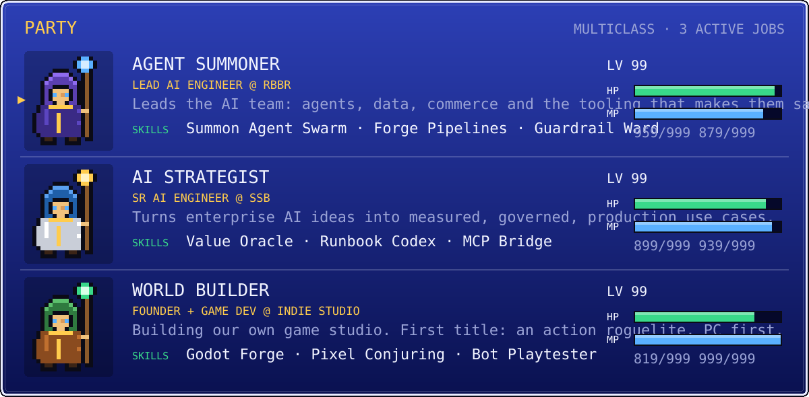
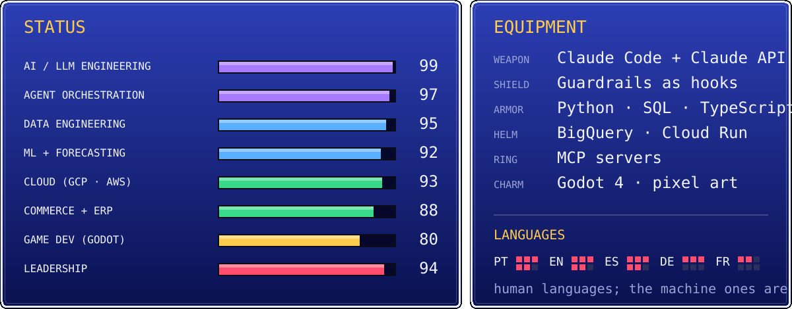
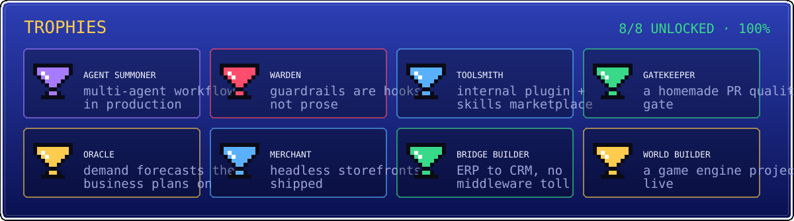

<p align="center">
  
</p>

<p align="center">
  
</p>

<p align="center">
  <a href="https://www.linkedin.com/in/leandro-sartini/"></a>
  
  
</p>

---

## 📜 Prologue

An AI engineer who levels up in three worlds at once. By day I lead AI at **RBBR** and build enterprise AI at **SSB**: agent swarms, data pipelines, forecasts and the guardrails that keep all of it safe in production. By night I'm founding **our own game studio**.

Before this run: **Mercado Livre** (Senior ML Engineer, Data Scientist) and **Bayer** (Data Scientist). Computer Engineering degree, plus graduate studies in AI and Data Science in Canada.

<p align="center">
  
</p>

## 🗺️ World map

<details open>
<summary><b>🏰 REALM I · RBBR</b>, Lead AI Engineer <i>(click to collapse)</i></summary>
<br/>

I lead the AI and data team at a Brazilian consumer-brands company, and in practice we build its tech in-house: agents, pipelines, storefronts and the platform under them.

| Dungeon | What we cleared there |
|---|---|
| 🤖 **Agent Citadel** | Claude Code as the team's engine: a plugin + skills marketplace, multi-agent workflows, a desktop agent hub with tag-driven releases |
| 🛡️ **Guardrail Keep** | rules enforced by hooks, not docs: guarded prod surfaces, lint-on-write, commit and push conventions that can't be skipped |
| 🔮 **Oracle Tower** | sell-in and sell-out forecasting that sets real targets, refreshed hourly into dashboards |
| ⛏️ **Pipeline Mines** | Cloud Run jobs moving ERP, CRM, marketplace and retailer data into BigQuery, audited and rerun-safe |
| 🌉 **Bridge of Systems** | in-house ERP ⇄ CRM sync on change-data-capture + Pub/Sub, replacing paid middleware |
| 🛒 **Merchant Quarter** | headless storefronts on Shopify Hydrogen/Oxygen and VTEX IO, with dev/test/prod envs and analytics on every interaction |
| 📨 **Scribe's Hall** | AI that reads purchase orders from the inbox and turns them into quotes nobody has to type |
| 📊 **Crystal Hub** | one SSO hub of internal dashboards, per-card access control, a Claude chat in each |
| 🧭 **Quest Board** | our own work tracker, wired into GitHub checks so no PR merges without its quest |

</details>

<details>
<summary><b>🏛️ REALM II · SSB</b>, Sr AI Engineer <i>(click to open)</i></summary>
<br/>

Enterprise AI at scale: ideas go in one end and come out as governed, measured production use cases.

| Dungeon | What we do there |
|---|---|
| 📥 **Idea Gate** | use-case intake, tiering and prioritization scoring |
| ⚖️ **Hall of Value** | value hypotheses tied to real metrics, measured and validated before anyone calls it a win |
| 📚 **Runbook Library** | standard runbooks for every AI system that ships, linted against a house standard |
| 🔌 **MCP Bridges** | MCP servers that let agents work the portfolio directly, next to the M365 work graph |

</details>

<details>
<summary><b>🌋 REALM III · OUR GAME STUDIO</b>, Founder + Game Dev <i>(click to open)</i></summary>
<br/>

A small indie studio, built the way we build everything else: with agents in the loop.

| Dungeon | What lives there |
|---|---|
| 🎮 **First title** | an action roguelite in **Godot 4**, PC first, codename sealed until the reveal |
| 🎨 **Pixel Atelier** | AI-assisted pixel art through MCP, every sprite judged and approved before it ships |
| 🤖 **Bot Arena** | an autotest bot that plays the game headless and screenshots each run, so balance is measured, not guessed |
| 📖 **Game Bible** | a living design doc the whole design rides on |

</details>

## ⚔️ Quest log

<details open>
<summary><b>📜 Current and completed quests</b></summary>
<br/>

**🔥 Active quests**
- [ ] Bring sales, support and B2C onto one in-house platform
- [ ] Ship the studio's first title to Steam
- [ ] Make every agent run measurable: cost, time saved, value delivered

**🏆 Main quests cleared**
- [x] **Agent platform**: plugins, skills, hooks and shared memory that every engineer runs on
- [x] **Homemade quality gate**: lint, coverage on changed lines, a review bot, and results in the warehouse
- [x] **Forecasting jobs** live: yearly goals, hourly refresh, sell-out tied to sell-in
- [x] **Storefronts** shipped on two commerce platforms, three environments each
- [x] **Work tracker** in-house, replacing a SaaS tool and gating every PR

**🧩 Side quests**
- [x] A voice agent that presents in meetings
- [x] A shared Python dev kit for secrets, BigQuery, auth and telemetry across every job
- [x] A multi-session hub to watch many Claude Code sessions at once

</details>

<details>
<summary><b>🐲 Bestiary: bosses defeated</b> <i>(click to open)</i></summary>
<br/>

| Boss | Its attack | How it fell | Drop |
|---|---|---|---|
| 🗿 **The Prose Golem** | rules written in docs, ignored at 2 AM | every rule became a hook that rejects the command | *enforcement > documentation* |
| 🐍 **The Ouroboros Kill** | a process kill whose pattern matched its own shell | match the executable, never the command line | *know what your tools match* |
| 👻 **The Silent Flush Wraith** | batched events that never left a serverless container | await every publish before the request ends | *no fire-and-forget on serverless* |
| 🪞 **The Fixture Illusionist** | green tests, NULL columns in prod | e2e against real systems, measure the NULLs | *tests prove reality, not consistency* |
| 🎭 **The Blank Secret Mimic** | config pull returned secrets empty, push wiped them | secrets only through the admin path | *round trips aren't idempotent* |
| 🧌 **The Middleware Toll Troll** | charged per integration, every month | in-house change-data-capture bridge | *own the critical path* |

</details>

---

<p align="center">
  
</p>

## 🎒 Inventory

<p align="center">
  
  <br/>
  
</p>

<p align="center">
  
  
  
  
  
  
  
  
  
  
  
  
  
  
</p>

<details>
<summary><b>🔍 Inspect items</b></summary>
<br/>

| Item | Rarity | Effect |
|---|---|---|
| 🤖 Claude Code + API | ⭐⭐⭐⭐⭐ Legendary | summons agents that write, review, test and ship |
| 🐍 Python | ⭐⭐⭐⭐⭐ Legendary | every job, every service, every model |
| 🔷 BigQuery | ⭐⭐⭐⭐⭐ Legendary | the save file of the whole kingdom |
| 🔌 MCP | ⭐⭐⭐⭐ Epic | hands agents real tools instead of copy-paste |
| ☁️ Cloud Run + Pub/Sub | ⭐⭐⭐⭐ Epic | jobs on a schedule, events in real time, scale to zero |
| 🎭 Playwright | ⭐⭐⭐ Rare | sees every page like a user before it ships |
| 🕹️ Godot 4 | ⭐⭐⭐ Rare | the forge where the studio's worlds are built |

</details>

---

<p align="center">
  
</p>

## 🕯️ Bonus dungeon: my contribution graph, crawled live

<p align="center">
  
</p>

<details>
<summary><b>💾 Load save file</b></summary>
<br/>

```text
SAVE FILE 01 ──────────────── LOADED
class............ summoner / strategist / world builder
rule #1.......... guardrails are code, not prose
rule #2.......... tests hit real systems
rule #3.......... ship it, measure it, then iterate
rule #4.......... if a task repeats, an agent does it next time
continue? ▶ YES   NO
```

</details>

<p align="center">
  
  <br/><sub>THE PRINCESS IS IN ANOTHER CASTLE. THE AGENTS ARE IN THIS ONE. 🏰</sub>
</p>
